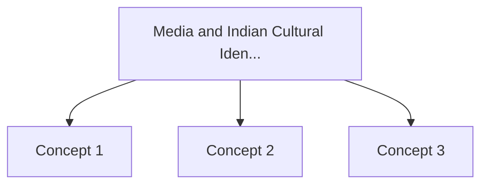

<!-- STUB:AUTO-GENERATED -->

# Media and Indian Cultural Identity

> **Paper**: MAMC-401 — Media and Cultural Studies  
> **Unit 3**: Media and Indian Culture  
> **Status**: 🔴 Draft — awaiting contributor  

---

## Definition

_Write a clear academic definition of "Media and Indian Cultural Identity" here._

---

## Key Concepts / Models

- Point 1
- Point 2
- Point 3

---

## Diagram

---

## Examples (Chhattisgarh / India Context)

_Provide real-world examples relevant to Chhattisgarh and Indian media landscape._

1. Example 1
2. Example 2

---

## Exam-Style Questions

### Short Answer (5 marks — ≤100 words)

1. Define "Media and Indian Cultural Identity" in brief.
2. _(Add more short questions)_

### Long Answer (10 marks)

1. Discuss the concept of "Media and Indian Cultural Identity" with suitable examples.
2. _(Add more long answer questions)_

---

## Further Reading

- _Recommend textbook chapters, journal articles, or web resources._

---

## References

- _List all sources cited in this note._

---

> **How to contribute**: Replace this stub content with your notes. Keep the frontmatter intact. Change `status` from "draft" to "review" when ready.  
> See [Contribution Guide](/ktujm/contribute/) for detailed instructions.
